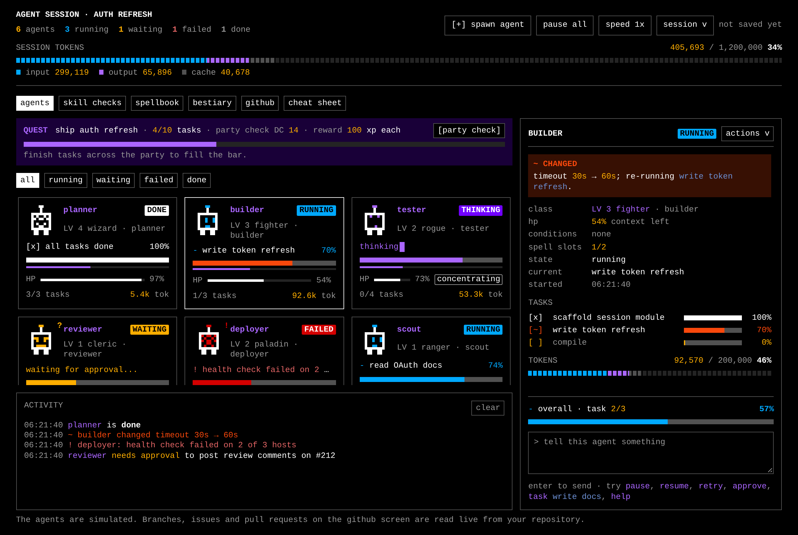
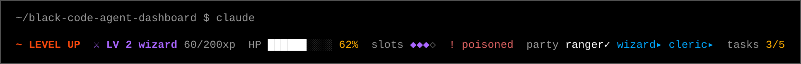
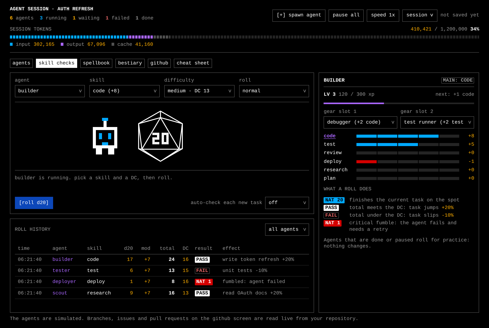
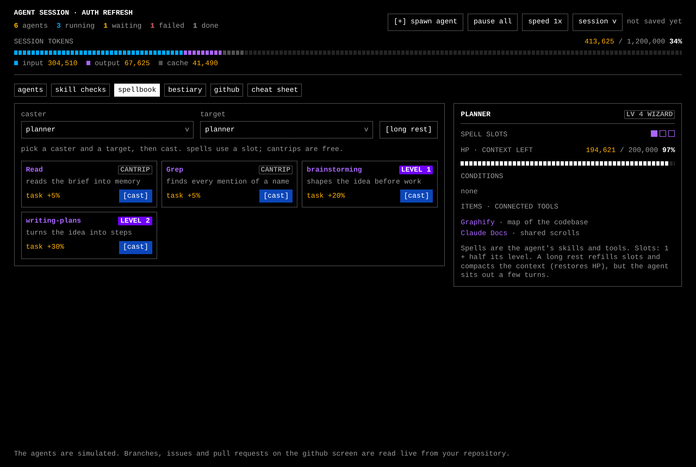
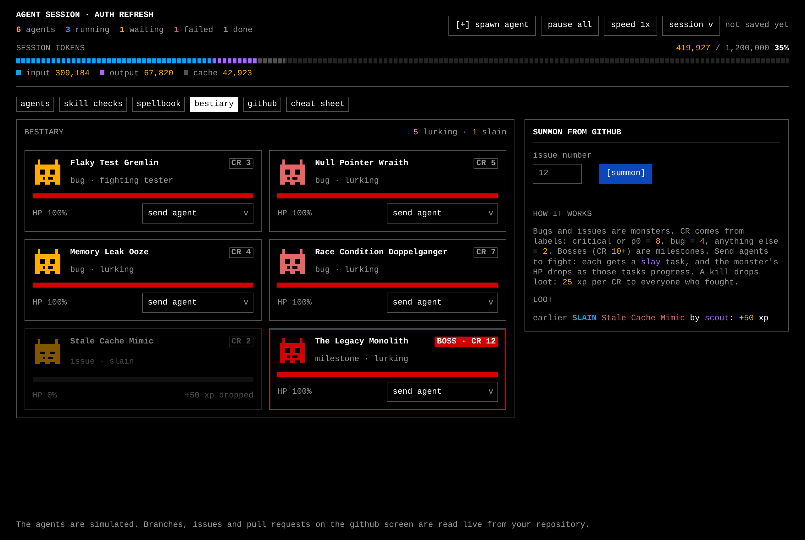
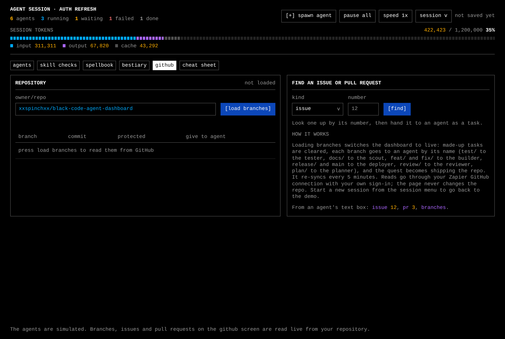
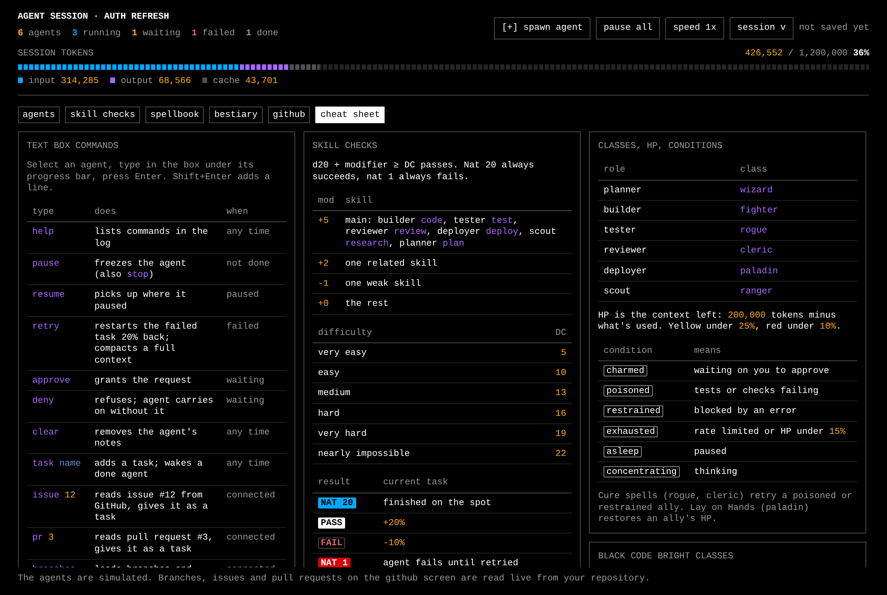

# black-code-agent-dashboard
agent dasbarod with a dnd twist

A terminal-style control room for agents, built on the **Black Code Bright** design system: solid black background, white text, gray borders, Courier New 13px / 1.25 everywhere. Red means critical, orange means something changed.



## What's in it
- `index.html`: the whole dashboard in one self-contained file (no build step)
- `terminal/`: a Claude Code status line that shows your real session as a party (HP, conditions, subagents, xp)

## Install

### The dashboard

There is nothing to build or install. Clone the repo and open the file:

```bash
git clone https://github.com/xxspinchxx/black-code-agent-dashboard.git
cd black-code-agent-dashboard
open index.html        # macOS
xdg-open index.html    # Linux
start index.html       # Windows
```

Opened as a claude.ai artifact, it saves to your account and reads GitHub through your MCP connection. Opened anywhere else, it saves in the browser and the github screen is read-only demo text.

### The terminal status line

Needs Node, which Claude Code already uses. From the repo folder:

```bash
node terminal/install.js                  # you start as a fighter
node terminal/install.js --class wizard   # or wizard, rogue, cleric, paladin, ranger
```

Then restart Claude Code. The status line shows up at the bottom of the terminal:



What the installer does:
- copies three scripts to `~/.claude/bcb/`
- adds the status line and hooks to `~/.claude/settings.json`, keeping your other hooks
- saves your settings from before the first install to `~/.claude/settings.json.bcb-original`

The hooks never block Claude and print nothing. Running the installer again with a different `--class` changes your class and keeps your level and xp.

To remove it (this puts back any status line it replaced; your party data stays in `~/.claude/bcb/`):

```bash
node terminal/install.js --uninstall
```

See [`terminal/README.md`](terminal/README.md) for what every part of the line means.

## Screens

| | |
|---|---|
| **agents**: pixel-robot agents, their tasks, notes, token use, and a text box to command them | **skill checks**: d20 + modifier vs DC, with levels, XP and gear |
|  |  |
| **spellbook**: an agent's skills and tools as spells; casting one uses a slot and pushes a task forward, and a long rest refills slots | **bestiary**: bugs and issues as monsters rated by CR; send agents to fight them for xp |
|  |  |
| **github**: reads branches, issues and PRs from a repo and turns them into agent tasks (live mode) | **cheat sheet**: every command, rule and design token |
|  |  |
